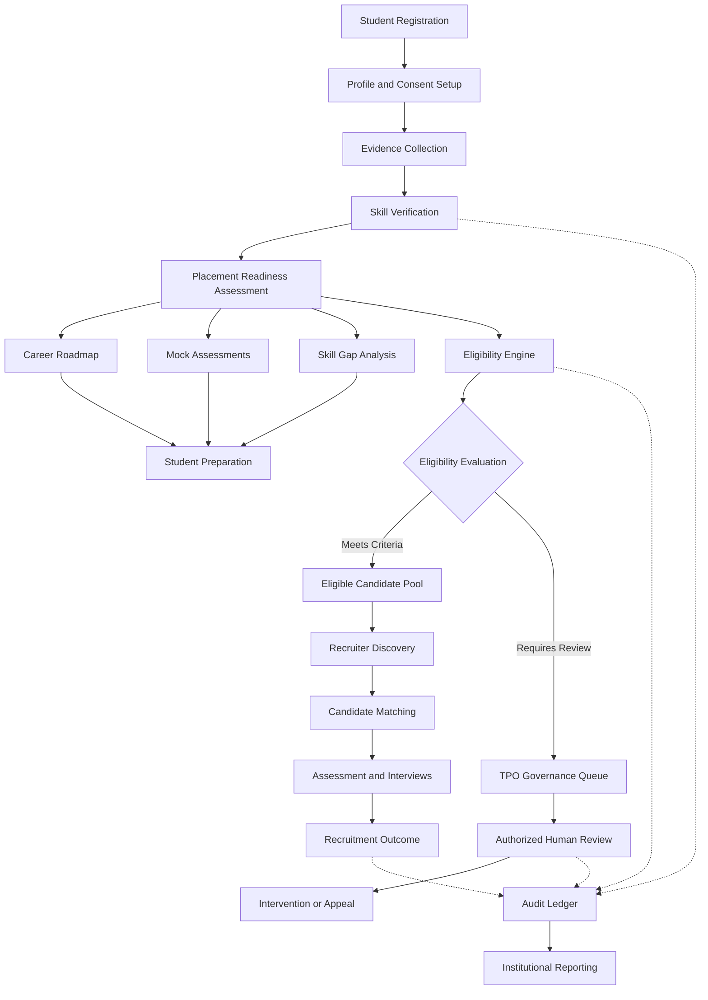
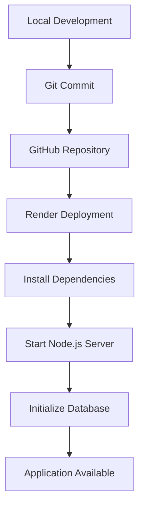

# EDTECH — Agentic Placement Intelligence Platform

**An AI-powered, evidence-driven ecosystem for intelligent campus placements, student readiness, and institutional hiring governance.**

EDTECH is a comprehensive, multi-tenant placement intelligence platform designed to modernize the campus recruitment ecosystem. It connects students, Training & Placement Officers (TPOs), recruiters, and university administrators through a unified system powered by AI-assisted analytics, verified skill evidence, intelligent automation, and cryptographically auditable records.

The platform transforms traditional placement management into a structured, transparent, and data-driven process — helping students prepare effectively, institutions identify skill gaps, and recruiters discover qualified talent.

---

## Project Overview

[](https://agentic-placement-intelligence.onrender.com)
[](https://github.com/nimeshsurvegg-lgtm/agentic-placement-intelligence)


| Environment | Link |
|---|---|
| Live Application | https://agentic-placement-intelligence.onrender.com |
| GitHub Repository | https://github.com/nimeshsurvegg-lgtm/agentic-placement-intelligence |
| Local Development | http://localhost:3000 |

---

# Table of Contents

1. [Introduction](#1-introduction)
2. [Problems EDTECH Addresses](#2-problems-edtech-addresses)
3. [Core Principles](#3-core-principles)
4. [Platform Architecture](#4-platform-architecture)
5. [Technology Stack](#5-technology-stack)
6. [Platform Modules](#6-platform-modules)
   - Student Portal
   - TPO Administration Portal
   - Recruiter Portal
   - University Administration Portal
7. [Agentic AI Architecture](#7-agentic-ai-architecture)
8. [Placement Intelligence Workflow](#8-placement-intelligence-workflow)
9. [Security, Privacy and Governance](#9-security-privacy-and-governance)
10. [Database Architecture](#10-database-architecture)
11. [REST API Reference](#11-rest-api-reference)
12. [Project Structure](#12-project-structure)
13. [Installation and Local Setup](#13-installation-and-local-setup)
14. [Production Deployment](#14-production-deployment)
15. [Demo Accounts](#15-demo-accounts)
16. [Testing and Verification](#16-testing-and-verification)
17. [Future Development](#17-future-development)
18. [Compliance and Disclaimers](#18-compliance-and-disclaimers)

---

# 1. Introduction

Campus placement processes often operate across disconnected systems, spreadsheets, static resumes, and manual communication channels.

This creates challenges for every stakeholder:

- Students lack a clear understanding of their placement readiness and skill gaps.
- Training and Placement Officers struggle to monitor large student cohorts.
- Recruiters spend considerable time evaluating unstructured and unverified candidate information.
- Institutions face difficulties maintaining transparent placement records and generating reliable accreditation reports.

EDTECH addresses these challenges through a unified placement intelligence ecosystem.

The platform integrates:

- AI-assisted student readiness assessment.
- Evidence-backed skill verification.
- Personalized career roadmaps.
- Interactive placement preparation.
- Intelligent recruiter-candidate matching.
- Automated institutional analytics.
- Human-governed placement decisions.
- Tamper-evident audit records.
- Multi-institutional data management.

### Mission

To create a transparent, intelligent, and accountable campus placement ecosystem where student capabilities are supported by evidence, institutional decisions are explainable, and recruitment processes are more efficient.

---

# 2. Problems EDTECH Addresses

| Existing Challenge | EDTECH Solution |
|---|---|
| Unverified student skills | Evidence-linked skill verification system |
| Static resumes | Dynamic student competency profiles |
| Lack of placement preparation tracking | Multi-pillar readiness assessment |
| Unstructured learning | Personalized career roadmaps |
| Manual eligibility checking | Declarative eligibility engine |
| Delayed student intervention | Proactive student support queue |
| Inefficient recruiter screening | Intelligent candidate discovery |
| Limited placement analytics | Predictive institutional dashboards |
| Opaque placement decisions | Explainable decision records |
| Inconsistent institutional reporting | Structured accreditation exports |
| Data integrity concerns | SHA-256 tamper-evident audit ledger |
| Multiple colleges sharing infrastructure | Multi-tenant data isolation |

---

# 3. Core Principles

EDTECH is built around five fundamental principles.

### 3.1 Evidence-Based Skill Verification

A student claiming a particular skill does not automatically make that skill verified.

Skills follow a structured lifecycle:

`Claimed → Observed → Evidence-Linked → Verified → Expired`

Supporting evidence can include:

- Verified projects.
- Repository activity.
- Certifications.
- Assessment results.
- Practical laboratory work.
- Authorized institutional verification.

### 3.2 Human-in-the-Loop Decision Making

AI assists institutional decision-making but does not independently determine a student's placement eligibility or impose penalties.

Important decisions require authorized human review.

### 3.3 Explainable Intelligence

Every recommendation should have an understandable explanation.

Examples include:

- Why a student matches a particular job role.
- Which skills are missing.
- Why an eligibility condition was not satisfied.
- Which preparation activities could improve readiness.

### 3.4 Multi-Tenant Data Isolation

Each institution operates within its authorized data environment.

Students, TPOs, and recruiters can access only the information permitted by their roles and institutional relationships.

### 3.5 Privacy and Accountability

Personal data access is governed through permissions, consent mechanisms, and auditable operations.

---

# 4. Platform Architecture

EDTECH follows a modular client-server architecture.

```text
                  EDTECH PLATFORM
                         |
          +--------------+--------------+
          |                             |
      CLIENT LAYER                  SERVER LAYER
          |                             |
    HTML5 / CSS3                  Node.js 22+
    JavaScript ES2024             Express 5
    Chart.js                      REST API
    Lucide Icons                  JWT Authentication
          |                             |
          +--------------+--------------+
                         |
                  SERVICE LAYER
                         |
       +-----------------+------------------+
       |                 |                  |
   AUTH SERVICE      AI AGENTS        GOVERNANCE
       |                 |                  |
   JWT / RBAC        Analytics         Eligibility
   Sessions          Skill Gaps        Audit Ledger
   Permissions       Forecasting       Fairness
       |                 |                  |
       +-----------------+------------------+
                         |
                   DATA LAYER
                         |
                    SQLite
                         |
              42 Relational Tables
                         |
          Persistent Institutional Records
```

### 4.1 Application Layer

The frontend provides dedicated interfaces for students, TPO administrators, recruiters, and university administrators.

It includes:

- Responsive application layouts.
- Dynamic dashboards.
- Interactive charts.
- Role-based navigation.
- Reusable UI components.
- Light and dark appearance modes.
- Context-aware modals and panels.

### 4.2 Backend Layer

The backend handles:

- Authentication and session management.
- Role-based authorization.
- Tenant-specific data access.
- Placement eligibility.
- Student readiness calculations.
- AI-assisted workflows.
- Audit logging.
- Institutional reporting.

### 4.3 Data Layer

The platform uses SQLite with Node.js native SQLite support.

Database responsibilities include:

- Student records.
- Institutional information.
- Placement drives.
- Skill evidence.
- Applications.
- Readiness assessments.
- Agent execution records.
- Audit history.
- Governance decisions.

---

# 5. Technology Stack

| Category | Technologies |
|---|---|
| Frontend | HTML5, CSS3, Vanilla JavaScript |
| JavaScript Standard | ES2024 Modules |
| Backend | Node.js 22.5+, Express 5 |
| Database | SQLite (`node:sqlite`) |
| Authentication | JWT, bcryptjs, Cookie Parser |
| Authorization | Role-Based Access Control |
| Security | HTTP-only Cookies, SHA-256, Ed25519 |
| Data Visualization | Chart.js |
| Icons | Lucide SVG |
| Spreadsheet Export | ExcelJS |
| API Architecture | REST, JSON |
| Deployment | Render |
| Version Control | Git, GitHub |
| Testing | Node.js Integration Tests |

### Why This Stack?

The architecture emphasizes:

- Lightweight deployment.
- Modular development.
- Efficient database operations.
- Maintainable frontend components.
- Secure authentication.
- Extensible service architecture.
- Compatibility with modern JavaScript runtimes.

---

# 6. Platform Modules

EDTECH provides four dedicated stakeholder environments.

## 6.1 Student Portal — Placement Command Center

The Student Portal provides a centralized environment for placement preparation, career development, and application tracking.

### A. Student Identity and Credentials

- Digital student placement identity.
- Institutional information.
- QR-based credential verification.
- Student profile and competency information.
- Exportable identity credentials.

### B. Placement Readiness Intelligence

A composite readiness assessment evaluates six dimensions:

| Assessment Pillar | Purpose |
|---|---|
| Technical Mastery | Programming and technical knowledge |
| Aptitude and Logic | Quantitative and logical reasoning |
| Project Engineering | Practical project development |
| Resume Health | Resume quality and ATS readiness |
| Interview Performance | Technical interview preparation |
| Communication | Articulation and response quality |

The dashboard provides:

- Overall readiness score.
- Individual pillar scores.
- Progression history.
- Identified skill gaps.
- Personalized improvement recommendations.

### C. Career Roadmaps

Structured 30-60-90 day preparation roadmaps for:

1. Full Stack Engineering.
2. Backend Engineering.
3. Artificial Intelligence and Machine Learning.
4. Cloud and DevOps.
5. Data Analytics and Business Intelligence.

Each roadmap includes:

- Learning milestones.
- Technical competencies.
- Recommended activities.
- Progress tracking.
- Completion indicators.

### D. Coding and Technical Preparation

An interactive coding preparation environment with:

- Difficulty-based problem filtering.
- Topic-based categorization.
- Coding problem statements.
- Example test cases.
- Starter code.
- Test execution interface.
- Preparation progress tracking.

### E. Project Portfolio Management

Students can maintain structured project portfolios containing:

- Project descriptions.
- Technologies used.
- GitHub repository links.
- Live deployment links.
- Repository activity information.
- Code complexity metrics.
- Evidence and verification status.

### F. Skill Verification System

A centralized skill graph displays:

- Claimed skills.
- Observed skills.
- Evidence-linked skills.
- Verified skills.
- Expired skills.

Each skill can be associated with supporting evidence and its verification history.

### G. Company Skill Gap Analysis

Students can compare their existing competencies against employer requirements.

The system highlights:

- Matching competencies.
- Missing technical skills.
- Academic eligibility conditions.
- Recommended preparation activities.
- Role-specific improvement opportunities.

### H. AI Technical Interview Lab

An interview preparation environment using the STAR framework:

- Situation.
- Task.
- Action.
- Result.

The evaluation framework provides feedback on:

- Technical depth.
- Problem-solving approach.
- Communication.
- Response structure.
- Areas requiring improvement.

### I. Mock Placement Simulator

A multi-stage placement simulation covering:

**Round 1 — Aptitude Assessment**

Quantitative, verbal, and logical reasoning questions with timed assessment.

**Round 2 — Machine Coding**

Practical programming challenges with test-case evaluation.

**Round 3 — Technical Interview**

Scenario-based technical and behavioral interview evaluation.

**Final Diagnostic Report**

A consolidated performance report containing assessment results, identified weaknesses, and recommended preparation activities.

### J. Opportunities Directory

A unified directory containing:

- Campus placement drives.
- Off-campus opportunities.
- Internships.
- Hackathons.
- Bookmarked opportunities.

### K. Application Tracking

A Kanban-style application lifecycle:

`Saved → Applied → Online Assessment → Shortlisted → Technical Interview → Offer`

Students can monitor their application progress.

### L. Alumni Mentorship

- Verified alumni directory.
- Mentor profiles.
- Mentorship requests.
- Available session slots.
- Session scheduling.

### M. Placement Calendar

A centralized calendar for:

- Placement drives.
- Application deadlines.
- Assessments.
- Interviews.
- Mentorship sessions.
- Preparation activities.

### N. Resume Builder

Multiple resume layouts with:

- ATS-oriented formatting.
- Structured education details.
- Skills and project sections.
- Experience information.
- Download and print functionality.

### O. AI Placement Copilot

A context-aware assistant designed to help students understand:

- Placement eligibility.
- Readiness scores.
- Missing competencies.
- Career roadmaps.
- Target company requirements.
- Available opportunities.

---

## 6.2 TPO Administration Portal

The Training and Placement Officer portal provides institutional control over placement operations.

### A. Institutional Command Center

Centralized analytics covering:

- Placement progress.
- Student readiness.
- Verified skill coverage.
- Skill-gap closure.
- Recruitment activity.
- Shortlisting trends.

### B. AI Agents Management

A dedicated environment for monitoring and executing agent workflows.

Capabilities include:

- Industry skill-gap analysis.
- Batch readiness forecasting.
- Eligibility verification.
- Fairness monitoring.
- Recruiter matching.
- Workflow execution history.

### C. Student Monitoring

The student support system identifies students who may require additional assistance.

Potential indicators include:

- Academic backlogs.
- Assessment performance.
- Missing competencies.
- Preparation inactivity.
- Incomplete milestones.

All intervention recommendations remain subject to authorized TPO review.

### D. Cohort Skill Analytics

Institutional skill heatmaps allow officers to compare competency coverage across departments, including:

- Computer Science.
- Information Technology.
- Electronics.
- Mechanical Engineering.

### E. Recruiter Relationship Management

A centralized corporate relationship directory containing:

- Employer profiles.
- Recruitment history.
- Hiring requirements.
- MOU information.
- Contact information.
- Placement statistics.

### F. Placement Drive Scheduling

Drive scheduling capabilities include:

- Recruitment event management.
- Schedule coordination.
- Conflict detection.
- Laboratory and auditorium availability.
- Examination schedule coordination.

### G. Recruiter Communication

Bulk communication facilities with:

- Personalized message templates.
- Variable substitution.
- Campaign management.
- Delivery and confirmation tracking.

### H. Governance and Approval Center

A centralized approval queue for:

- Eligibility overrides.
- Student appeals.
- Mentor assignments.
- Intervention recommendations.
- Agent-generated suggestions.

### I. Fairness and Bias Monitoring

Monitoring tools calculate selection and adverse-impact indicators across supported demographic and academic groups.

The results are intended to assist institutional review, not replace legal or human fairness assessments.

### J. Cryptographic Audit Explorer

The audit explorer provides visibility into:

- Sequential ledger entries.
- Timestamps.
- Actor identifiers.
- Transaction information.
- Cryptographic hashes.
- Previous-block references.
- Chain integrity verification.

---

## 6.3 Recruiter Portal — Talent Discovery

The Recruiter Portal provides a structured candidate discovery and assessment environment.

### A. Candidate Discovery

Recruiters can explore authorized student profiles using filters such as:

- Verified skills.
- Academic performance.
- CGPA.
- Active backlogs.
- Engineering department.
- Placement availability.

### B. Intelligent Candidate Matching

The matching engine evaluates candidate suitability using relevant criteria.

Match explanations can include:

- Required skill coverage.
- Verified competencies.
- Academic eligibility.
- Project experience.
- Role-specific requirements.

### C. Candidate Dossiers

Detailed candidate profiles provide authorized access to:

- Academic information.
- Verified skills.
- Project portfolios.
- Repository evidence.
- Assessment results.
- Credential information.
- Audit history.

### D. Assessment Management

Recruiters can create assessment challenges involving:

- Multiple-choice questions.
- Programming assessments.
- Technical questions.
- Structured interview responses.

### E. Interview Coordination

- Candidate scheduling.
- Interview slot management.
- Interview feedback.
- Recruitment progress tracking.

---

## 6.4 University Administration Portal

The University Administration Portal provides institutional-level oversight across affiliated colleges.

### A. Institutional Benchmarking

Compare participating institutions using:

- Placement statistics.
- Student readiness.
- Skill coverage.
- Recruitment outcomes.
- Department-level metrics.

### B. Accreditation Reporting

Structured reporting capabilities for:

- NAAC Criterion 5.2.1.
- NIRF placement-related reporting.
- Institutional placement records.
- Student outcome datasets.

### C. Multi-Tenant Governance

- Institution-level data isolation.
- Cross-institutional analytics.
- Authorized administrative access.
- Tenant boundary verification.
- Centralized institutional oversight.

---

# 7. Agentic AI Architecture

EDTECH incorporates specialized agent workflows to support institutional operations and student development.

The architecture follows a controlled automation approach in which agents analyze information, generate recommendations, and record execution results.

## 7.1 Industry Skill-Gap Profiler

**Purpose:** Identify the difference between industry requirements and existing student competencies.

Responsibilities:

- Analyze available job descriptions.
- Extract technical requirements.
- Identify recurring industry skills.
- Compare employer demand with student skill coverage.
- Detect institutional competency gaps.
- Recommend workshops and learning interventions.

## 7.2 Predictive Placement Analytics Agent

**Purpose:** Assist institutions in understanding placement readiness trends.

Responsibilities:

- Analyze historical and current placement indicators.
- Evaluate cohort-level readiness.
- Identify students requiring additional support.
- Generate placement forecasts.
- Recommend early interventions.

Predictions should be treated as analytical estimates rather than guaranteed placement outcomes.

## 7.3 Declarative Eligibility Agent

**Purpose:** Evaluate student eligibility against predefined placement rules.

Responsibilities:

- Evaluate academic requirements.
- Check backlog conditions.
- Verify skill requirements.
- Apply versioned eligibility rules.
- Generate explainable decisions.
- Record evaluation information.

## 7.4 Fairness and Bias Monitoring Agent

**Purpose:** Identify potential differences in recruitment outcomes across supported groups.

Responsibilities:

- Calculate selection-rate ratios.
- Identify disparities.
- Generate fairness reports.
- Highlight potential adverse impacts.
- Support human governance reviews.

## 7.5 AI Technical Interview Evaluator

**Purpose:** Assist students in improving interview performance.

Responsibilities:

- Evaluate structured responses.
- Apply STAR-based assessment criteria.
- Assess technical depth.
- Analyze response organization.
- Generate improvement suggestions.

## 7.6 AI Placement Copilot

**Purpose:** Provide contextual placement assistance.

Responsibilities:

- Answer placement-related questions.
- Explain eligibility requirements.
- Identify missing competencies.
- Recommend preparation activities.
- Interpret student readiness information.
- Provide contextual guidance using authorized records.

### Agent Governance

All important placement-affecting decisions remain subject to authorized institutional approval.

Agent execution history and applicable governance actions are recorded for accountability.

---

# 8. Placement Intelligence Workflow

The platform connects student development, institutional governance, and recruitment through an integrated workflow.



### Workflow Benefits

- Structured student preparation.
- Evidence-backed competency tracking.
- Consistent eligibility evaluation.
- Transparent institutional intervention.
- More efficient recruiter discovery.
- Auditable placement operations.

---

# 9. Security, Privacy and Governance

Security and accountability are central architectural considerations.

## 9.1 Authentication and Authorization

The platform incorporates:

- JWT-based authentication.
- HTTP-only authentication cookies.
- Password hashing using bcrypt.
- Role-based access control.
- Tenant-specific authorization.
- Protected API endpoints.

## 9.2 Multi-Tenant Isolation

Institutional data is separated through tenant-aware database access and authorization controls.

The architecture is designed to prevent unauthorized access between institutions.

## 9.3 SHA-256 Tamper-Evident Audit Ledger

Important institutional actions can be recorded in a hash-linked audit ledger.

The block hash is calculated using a structure such as:

```text
BlockHash = SHA256(
    Index +
    PreviousHash +
    Timestamp +
    TenantId +
    Payload
)
```

Each new entry references the preceding block.

The integrity verification mechanism recalculates the chain to identify modifications or inconsistencies.

**Important:** A hash-linked audit ledger is tamper-evident; it is not a decentralized blockchain.

## 9.4 Digital Personal Data Protection

The platform incorporates privacy-oriented controls aligned with the principles of India's Digital Personal Data Protection Act, 2023.

These include:

- Purpose-specific consent mechanisms.
- Controlled access to student information.
- Read-only repository analysis where supported.
- Consent withdrawal mechanisms.
- Data minimization considerations.
- Erasure request handling.
- Auditability of relevant operations.

Actual legal compliance depends on the complete deployment, operational policies, data processing arrangements, and applicable legal requirements.

## 9.5 W3C Verifiable Credentials

The credential subsystem is designed to support digitally verifiable institutional credentials using:

- JSON-LD credential structures.
- Ed25519 cryptographic signatures.
- Credential verification.
- Institutional authenticity information.

## 9.6 Human Governance

AI-generated recommendations must not independently replace authorized institutional decisions.

Important actions such as eligibility overrides and student interventions require appropriate human authorization.

---

# 10. Database Architecture

The platform uses SQLite with Node.js native SQLite support.

The documented schema contains 42 relational tables:

- 33 core schema tables.
- 9 additional enterprise module tables.

### Database Categories

| Category | Main Entities |
|---|---|
| Identity and Authentication | tenants, users, sessions, password_resets, consents |
| Skills and Evidence | skills, student_skills, evidence, verification_rules, readiness_scores |
| Placement Management | companies, drives, applications, eligibility_decisions |
| Student Preparation | mock_questions, mock_attempts, learning_paths, learning_tasks |
| Enterprise Modules | career_roles, career_paths, portfolio_projects, opportunities |
| Mentorship | alumni_mentors, mentorship_requests |
| Governance | audit_logs, approval_queue, agent_runs, tpo_interventions |
| Privacy | erasure_requests |

### Database Responsibilities

- Persistent student records.
- Institutional relationships.
- Placement applications.
- Competency evidence.
- Readiness assessments.
- Agent execution records.
- Governance decisions.
- Cryptographic audit history.

The database is initialized automatically during application startup, with idempotent seeding for supported demo records.

---

# 11. REST API Reference

EDTECH exposes REST endpoints for authentication, student operations, preparation, institutional governance, and recruitment.

## Authentication — `/api/auth`

| Method | Endpoint | Description |
|---|---|---|
| POST | `/api/auth/login` | Authenticate and establish session |
| POST | `/api/auth/logout` | End authenticated session |
| GET | `/api/auth/me` | Retrieve current user |
| POST | `/api/auth/forgot-password` | Initiate password recovery |
| POST | `/api/auth/reset-password` | Reset password |

## Student Management — `/api/students`

| Method | Endpoint | Description |
|---|---|---|
| GET | `/api/students` | Retrieve authorized student records |
| GET | `/api/students/:id` | Retrieve student profile |
| GET | `/api/students/:id/readiness-score` | Retrieve readiness assessment |
| GET | `/api/students/:id/portfolio` | Retrieve student portfolio |
| POST | `/api/students/:id/portfolio/project` | Add portfolio project |
| GET | `/api/students/:id/applications-kanban` | Retrieve application stages |
| POST | `/api/applications/:id/stage` | Update application stage |
| GET | `/api/students/:id/calendar-events` | Retrieve placement calendar |
| GET | `/api/students/:id/w3c-vc` | Generate credential data |

## Career and Learning APIs

| Method | Endpoint | Description |
|---|---|---|
| GET | `/api/career-roles` | Retrieve career roles and roadmaps |
| GET | `/api/students/:id/role-gap/:roleId` | Evaluate role-specific skill gaps |
| GET | `/api/career-paths` | Retrieve career path information |

## Interview APIs — `/api/interview`

| Method | Endpoint | Description |
|---|---|---|
| GET | `/api/interview/questions?role=:role` | Retrieve interview questions |
| POST | `/api/interview/evaluate` | Evaluate interview response |

## Opportunities — `/api/opportunities`

| Method | Endpoint | Description |
|---|---|---|
| GET | `/api/opportunities` | Retrieve available opportunities |
| POST | `/api/opportunities/:id/save` | Save or bookmark opportunity |

## Alumni — `/api/alumni`

| Method | Endpoint | Description |
|---|---|---|
| GET | `/api/alumni/mentors` | Retrieve alumni mentors |
| POST | `/api/alumni/requests` | Submit mentorship request |

## TPO and Governance APIs

| Method | Endpoint | Description |
|---|---|---|
| GET | `/api/tpo/risk-queue` | Retrieve student support queue |
| POST | `/api/tpo/interventions/assign` | Assign student intervention |
| GET | `/api/crm/companies` | Retrieve recruiter directory |
| GET | `/api/workflows/history` | Retrieve agent workflow history |
| POST | `/api/workflows/trigger` | Execute supported workflow |
| GET | `/api/audit/entries` | Retrieve audit ledger entries |
| GET | `/api/audit/verify` | Verify audit chain integrity |

## AI Assistant — `/api/ai-assistant`

| Method | Endpoint | Description |
|---|---|---|
| POST | `/api/ai-assistant/chat` | Submit contextual placement query |

**API Security:** All protected endpoints must be accessed through the appropriate authentication, authorization, and tenant-scoping mechanisms.

---

# 12. Project Structure

```text
agentic-placement-intelligence/
│
├── .github/
│   └── workflows/
│       └── ci.yml
│
├── data/
│   ├── schema.sql
│   ├── placement.db
│   └── db.js
│
├── middleware/
│   └── auth.js
│
├── public/
│   ├── css/
│   │   └── style.css
│   │
│   ├── js/
│   │   ├── icons.js
│   │   ├── app.js
│   │   └── app-v2.js
│   │
│   ├── vendor/
│   │   └── chart.min.js
│   │
│   └── index.html
│
├── routes/
│   ├── api.js
│   └── auth.js
│
├── services/
│   ├── db.js
│   ├── initDb.js
│   ├── authService.js
│   ├── declarativeEligibility.js
│   ├── aiAgents.js
│   ├── mockDriveEngine.js
│   ├── fairnessMonitor.js
│   ├── accreditationExporter.js
│   └── crossTenantLeakTest.js
│
├── scripts/
│   ├── seed.js
│   ├── migrate_v2.js
│   └── test_v2_endpoints.js
│
├── tests/
│   └── test-suite.js
│
├── .gitignore
├── CODE_OF_CONDUCT.md
├── CONTRIBUTING.md
├── LICENSE
├── SECURITY.md
├── package.json
├── server.js
├── start.bat
└── README.md
```

---

# 13. Installation and Local Setup

## Prerequisites

Install the following before running the project:

| Requirement | Version |
|---|---|
| Node.js | 22.5.0 or higher |
| NPM | 9.0.0 or higher |
| Git | Latest stable version |
| Operating System | Windows, macOS or Linux |

Node.js 22.5+ is required for the native `node:sqlite` functionality used by the project.

## Step 1 — Clone the Repository

```bash
git clone https://github.com/nimeshsurvegg-lgtm/agentic-placement-intelligence.git
```

Navigate into the project:

```bash
cd agentic-placement-intelligence
```

## Step 2 — Install Dependencies

```bash
npm install
```

## Step 3 — Start the Application

Development mode:

```bash
npm run dev
```

Production mode:

```bash
npm start
```

The application should be accessible at:

```text
http://localhost:3000
```

## Step 4 — Database Initialization

On the first startup, the application initializes its database and supported schema.

The demo environment is designed to populate sample records, including:

- 120 cohort students.
- 310 aptitude questions.
- 12 companies.
- 6 placement drives.

Initialization and seeding should be safe to execute repeatedly where the corresponding idempotent routines are used.

## Step 5 — Run Tests

```bash
npm test
```

---

# 14. Production Deployment

The project supports deployment through Render using a connected GitHub repository.

### Deployment Workflow



### Recommended Configuration

| Setting | Value |
|---|---|
| Service Type | Web Service |
| Runtime | Node |
| Build Command | `npm install` |
| Start Command | `npm start` |
| Environment | Production |

### Important: Database Persistence

SQLite database files stored on temporary application filesystems may not survive service restarts, redeployments, or instance replacement.

For persistent production data, configure an appropriate persistent disk or migrate to a managed database.

The database initialization process should not overwrite existing institutional records during application restarts.

### Deployment URL

https://agentic-placement-intelligence.onrender.com

---

# 15. Demo Accounts

The application includes sample accounts for demonstrating its different stakeholder portals.

**Shared demo password:** `Demo@1234`

| Role | Demo Email | Institution |
|---|---|---|
| Student | `rahul@vppcoe.demo` | Premier Technological Institute |
| TPO Officer | `anil.kulkarni@vppcoe.demo` | Premier Technological Institute |
| Department Head | `hod.cs@vppcoe.demo` | Premier Technological Institute |
| Approved Recruiter | `recruiter@google.demo` | Google India |
| Pending Recruiter | `recruiter@barclays.demo` | Barclays Talent |
| University Chancellor | `chancellor@univ.demo` | University Network |
| TPO Officer — College B | `officer@coep.demo` | National Institute of Technology |

### Recommended Demonstration Sequence

**Student Portal**
- Explore the readiness dashboard.
- Review career roadmaps.
- Explore the skill verification system.
- Complete mock assessments.
- Review placement opportunities.

**TPO Portal**
- Explore institutional analytics.
- Execute supported agent workflows.
- Review student intervention requests.
- Inspect the audit ledger.

**Recruiter Portal**
- Explore candidate discovery.
- Review candidate profiles.
- Examine skill-match explanations.
- Explore assessment management.

**University Portal**
- Explore institutional benchmarking.
- Review accreditation reporting.
- Inspect tenant isolation capabilities.

**Security Note:** Demo credentials are intended exclusively for demonstration environments. Never reuse shared demo passwords in production.

---

# 16. Testing and Verification

The project includes an automated integration test suite.

Run the tests using:

```bash
npm test
```

### Documented Test Coverage

| No. | Test Area |
|---|---|
| 1 | Audit ledger genesis block |
| 2 | SHA-256 ledger integrity |
| 3 | Eligibility evaluation |
| 4 | Backlog-based eligibility rejection |
| 5 | Industry skill-gap analysis |
| 6 | Predictive analytics |
| 7 | Aptitude assessment scoring |
| 8 | Machine coding evaluation |
| 9 | Fairness ratio calculations |
| 10 | NAAC reporting |
| 11 | Cross-tenant isolation |
| 12 | Database auto-initialization |
| 13 | Multi-tenant data retrieval |
| 14 | Non-existent student handling |
| 15 | Idempotent database seeding |
| 16 | Enterprise schema initialization |
| 17 | Fresh database initialization |

**Previously reported test result:** 17/17 tests passed.

Always execute the latest test suite against the current code before claiming that a particular build passes all tests.

---

# 17. Future Development

Potential areas for continued platform development include:

- Integration with external applicant tracking systems.
- Live job description ingestion.
- Advanced AI-powered interview evaluation.
- More comprehensive student skill assessments.
- Real-time recruiter communication.
- University-wide analytics.
- Advanced predictive placement models.
- External credential verification integrations.
- Enhanced accessibility.
- Managed cloud database infrastructure.
- Automated institutional reporting.
- Expanded security and penetration testing.

These represent potential development directions and should not be interpreted as already implemented functionality.

---

# 18. Compliance and Disclaimers

### Data Protection

EDTECH incorporates privacy-oriented mechanisms designed with India's Digital Personal Data Protection Act, 2023 in mind.

The presence of these mechanisms does not independently establish full legal compliance. Actual compliance requires appropriate technical, contractual, organizational, and operational safeguards.

### AI Governance

AI-generated scores, predictions, recommendations, and assessments are decision-support outputs.

They should not replace authorized human review or be treated as guaranteed predictions of academic or recruitment outcomes.

### Accreditation

The reporting modules are designed to assist with institutional placement documentation and accreditation-related data preparation.

Institutions must independently validate exported information against the applicable official reporting requirements.

### Demonstration Data

Sample students, companies, placement statistics, assessment results, and recruiter information may be illustrative demonstration records rather than actual institutional or employer records.

### Production Readiness

The project is an evolving software platform. Security, privacy, performance, database persistence, and external integration requirements should be validated before deployment in a real institutional environment.

---

# Contributing

Contributions, suggestions, and improvements are welcome.

1. Fork the repository.
2. Create a feature branch.
3. Implement your changes.
4. Run the available tests.
5. Submit a pull request.

Please review `CONTRIBUTING.md` before submitting contributions.

For security-related concerns, refer to `SECURITY.md`.

---

# License

This project is distributed under the license specified in the repository's `LICENSE` file.

---

**EDTECH — Agentic Placement Intelligence Platform**

*Making campus placements more intelligent, transparent, evidence-driven, and accountable.*

