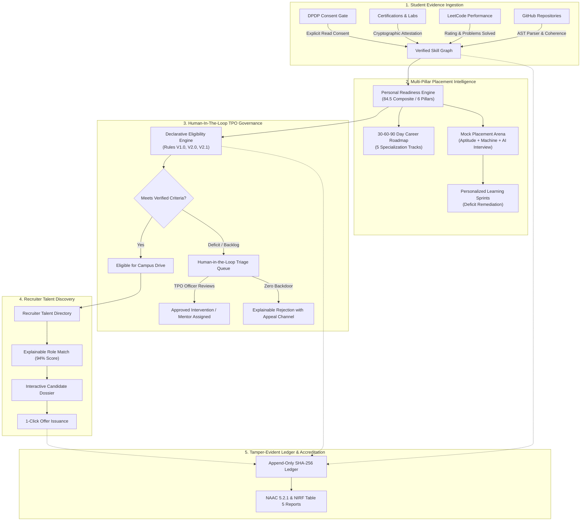
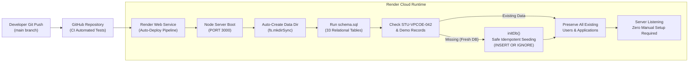

# EDTECH — Agentic Placement Intelligence Platform

[](https://agentic-placement-intelligence.onrender.com)
[](https://github.com/nimeshsurvegg-lgtm/agentic-placement-intelligence)

[](file:///tests/test-suite.js)
[](file:///services/db.js)
[](file:///services/blockchain.js)
[](file:///routes/api.js)
[](file:///public/js/app.js)

> 🌐 **Live Production Web Service**: **[https://agentic-placement-intelligence.onrender.com](https://agentic-placement-intelligence.onrender.com)**    
> 💻 **Local Development Instance**: [http://localhost:3000](http://localhost:3000)

---

## 📑 Table of Contents

1. [Executive Summary & Core Mission](#-executive-summary--core-mission)
2. [Hybrid Design System & Visual Identity](#-hybrid-design-system--visual-identity)
   - [Cockroach Janta Party Inspirations](#1-cockroach-janta-party-inspirations)
   - [LeetCode Inspirations](#2-leetcode-inspirations)
   - [Wellfound Inspirations](#3-wellfound-inspirations)
   - [Modern SaaS Foundation (Linear, Vercel, Stripe)](#4-modern-saas-foundation-linear-vercel-stripe)
3. [Architecture & Technology Stack](#-architecture--technology-stack)
   - [End-to-End Placement & Agentic Workflow](#-end-to-end-placement--agentic-workflow)
   - [Self-Healing Cloud Persistence Architecture](#production-deployment--self-healing-cloud-persistence)
4. [Stakeholder Portals & Feature Deep Dive](#-stakeholder-portals--feature-deep-dive)
   - [Portal 1: Student Placement Command](#portal-1-student-placement-command)
   - [Portal 2: Training & Placement Officer (TPO) Admin](#portal-2-training--placement-officer-tpo-admin)
   - [Portal 3: Recruiter Talent Discovery Hub](#portal-3-recruiter-talent-discovery-hub)
   - [Portal 4: University Chancellery & Institutional Network](#portal-4-university-chancellery--institutional-network)
5. [Autonomous Agent Architecture](#-autonomous-agent-architecture)
6. [Security, Governance & DPDP Act 2023 Compliance](#-security-governance--dpdp-act-2023-compliance)
7. [Database Schema & Entity Architecture](#-database-schema--entity-architecture)
8. [Comprehensive REST API Reference](#-comprehensive-rest-api-reference)
9. [Project Directory Structure](#-project-directory-structure)
10. [Quickstart & Installation Guide](#-quickstart--installation-guide)
11. [Demo Accounts Registry](#-demo-accounts-registry)
12. [Automated Verification & Test Suite](#-automated-verification--test-suite)

---

## 🎯 Executive Summary & Core Mission

Campus placements across technical colleges traditionally suffer from **three critical bottlenecks**:
1. **Unverified Claims**: Static PDF resumes and unverified self-reported skills lead to recruiter distrust and 40%+ dropouts during technical screening.
2. **Reactive Training**: Interventions and bootcamps are scheduled too late (during placement season rather than 6–12 months prior).
3. **Black-Box Disqualifications**: Students are disqualified without transparent reasons, while T&P teams lack defensible evidence chains for NAAC and NIRF audits.

### The EDTECH Main Principles:
- **NO SKILL IS EVER MARKED VERIFIED WITHOUT SUPPORTING EVIDENCE**: Enforced server-side in the data access layer. Skills transition through strict lifecycle states: `Claimed → Observed → Evidence-Linked → Verified → Expired`.
- **"AI HELPS, HUMAN DECIDES" GOVERNANCE**: No student is ever labeled "at-risk", penalized, or disqualified from a drive without authorized human T&P officer sign-off.
- **ZERO CROSS-TENANT DATA LEAKS**: Strict row-level cryptographic multi-tenancy ensures complete isolation between colleges under a shared university umbrella.
- **INDIA DPDP ACT 2023 COMPLIANCE**: Granular read-only consent gates, transparent purpose specification, and right-to-be-forgotten cryptographic erasure.

---

## 🎨 Hybrid Design System & Visual Identity

The platform fuses the best aspects of high-utility developer platforms with modern enterprise SaaS aesthetics:

```
┌─────────────────────────────────────────────────────────────────────────────┐
│                       HYBRID DESIGN PHILOSOPHY                              │
├──────────────────────┬──────────────────────┬───────────────────────────────┤
│ CockroachJantaParty  │       LeetCode       │           Wellfound           │
│  (Live Public Trust) │ (Competitive Arena)  │     (Recruiter Discovery)     │
├──────────────────────┼──────────────────────┼───────────────────────────────┤
│ • Holographic Pass   │ • Circular Gauge     │ • Pulse Active Status Dots    │
│ • SHA-256 Ledger Bar │ • Study Plan Tracks  │ • Explainable Match Factors   │
│ • Tamper Verification│ • Problemset Arena   │ • Sliding Dossier Drawers     │
│ • Zero Backdoor Tag  │ • 28-Day Heatmap     │ • High-Density Drives Grid    │
└──────────────────────┴──────────────────────┴───────────────────────────────┘
```

### 1. Cockroach Janta Party Inspirations
- **Verifiable National Placement Identity Pass**: A holographic ID pass with watermarked institutional seal, student credentials, live QR code linking to W3C JSON-LD, and cryptographic SHA-256 hash.
- **Live Integrity Ticker**: High-visibility ticker bar rendering real-time ledger commits, block heights, and zero-backdoor audit verification stamps.
- **1-Click Verification**: Anyone can verify student authenticity without logging in via public cryptographic links.

### 2. LeetCode Inspirations
- **Circular Solved Gauge**: SVG radial progress breakdown illustrating Easy, Medium, and Hard solved problems relative to institutional targets.
- **Placement Study Plans**: Curated tracks (e.g. *Top 50 Product Questions*, *SQL 20 Query Optimization*, *System Design & Docker 15*) with live progress bars.
- **28-Day Activity Flame Heatmap**: Visual streak indicator tracking daily commit and submission consistency.
- **High-Density Problemset Table**: Sortable, filterable coding arena with difficulty tags, topic pills, and interactive test case runner modal.

### 3. Wellfound Inspirations
- **Candidate Discovery Cards**: Clean recruiter-facing talent cards with verified skill tags, CGPA metrics, and active availability dots.
- **Explainable Match Breakdown**: Mathematical breakdown detailing why a student matches a target role (e.g. "94% Match: 4/4 Verified Core Skills, CGPA 8.42 > 7.50 Cutoff").
- **Sliding Dossier Drawers**: Deep-dive candidate drawers with inspectable GitHub AST commits, contest ratings, and tamper-evident audit logs.

### 4. Modern SaaS Foundation (Linear, Vercel, Stripe)
- **Palette**: Midnight navy base (`#060814` dark / `#f8fafc` light) with electric indigo (`#6366f1`) and emerald semantic accents.
- **Typography**: Inter / Geist font stack on an 8px layout grid with -0.02em letter spacing on headings.
- **Strictly Zero Emojis**: 100% crisp vector Lucide SVG icons (`lucide-react` style).
- **Subtle Elevation**: 1px borders (`#1e293b` / `#e2e8f0`) with soft shadows (no drop-shadows or unstyled borders).

---

## 🏗️ Architecture & Technology Stack

```
┌──────────────────────────────────────────────────────────────────────────┐
│                             CLIENT LAYER                                 │
│  Vanilla JS (ES2024 Modules) • Chart.js • Lucide SVGs • CSS Variables    │
│  Linear Design Tokens • Inter Typography • Light/Dark Mode Subsystem     │
└────────────────────────────────────┬─────────────────────────────────────┘
                                     │ HTTP / REST / JSON
┌────────────────────────────────────▼─────────────────────────────────────┐
│                          SERVER & ROUTE LAYER                            │
│  Node.js v26 • Express 5.3 • JWT Auth • Cookie-Parser • Zod Validation   │
│  Role-Based Access Control (RBAC) • Multi-Tenant Middleware              │
└────────────────────────────────────┬─────────────────────────────────────┘
                                     │
         ┌───────────────────────────┼───────────────────────────┐
         ▼                           ▼                           ▼
┌─────────────────┐         ┌─────────────────┐         ┌─────────────────┐
│ DATABASE ENGINE │         │ CRYPTO & LEDGER │         │ AGENT WORKFLOWS │
│ Native SQLite   │         │ Node Crypto     │         │ Rule Engine     │
│ (node:sqlite)   │         │ SHA-256 Chaining│         │ Industry Scanner│
│ 42 Tables       │         │ Ed25519 W3C VC  │         │ Bias Monitor    │
│ In-Memory Sync  │         │ Genesis Blocks  │         │ Interview STAR  │
└─────────────────┘         └─────────────────┘         └─────────────────┘
```

- **Runtime**: Node.js (v18+ or v26) using native high-performance SQLite (`node:sqlite`).
- **Backend Framework**: Express 5.3 with modular REST routing (`routes/api.js`, `routes/auth.js`).
- **Security & Tokens**: `bcryptjs` (Cost 12), `jsonwebtoken` (httpOnly cookies), rate-limiting middleware.
- **Exports Engine**: `exceljs` for multi-sheet NIRF/NAAC reports, browser-native print stylesheets for ATS resumes.
- **Data Integrity**: SHA-256 cryptographic linked-list blockchain ledger in `services/db.js` & `services/auditLedger.js`.

---

## 🔄 End-to-End Placement & Agentic Workflow

The platform connects student evidence ingestion to recruiter hiring decisions through an automated, explainable, human-governed pipeline:



### Production Deployment & Self-Healing Cloud Persistence



---

## 🌟 Stakeholder Portals & Feature Deep Dive

### Portal 1: Student Placement Command
1. **Verifiable Placement Identity Pass**: Holographic pass with dynamic QR code, roll number, verified repos count, and 1-click PNG/URL export.
2. **Personal Placement Readiness Score Widget**: Real-time aggregate score (84/100) across 6 core pillars:
   - *Technical Mastery (92%)*
   - *Aptitude & Logic (79%)*
   - *Project Engineering (90%)*
   - *ATS Resume Health (88%)*
   - *AI Mock Interview (77%)*
   - *Communication & Articulation (82%)*
   Includes monthly score progression history and prescriptive AI recommendations.
3. **30-60-90 Day Career Specialization Roadmaps**: Role-specific milestone roadmaps for:
   - Full Stack Engineer (12–24 LPA)
   - Backend Systems Engineer (16–30 LPA)
   - AI / Machine Learning Engineer (15–28 LPA)
   - Cloud & DevOps Engineer (14–26 LPA)
   - Data Analyst & BI Specialist (10–20 LPA)
   Features interactive milestone checkboxes updating your verification ledger in real-time.
4. **LeetCode Placement Problemset & Coding Arena**:
   - Filter by Difficulty (Easy, Medium, Hard), Status, and Tags (Algorithms, Database, System Design, Concurrency).
   - "Solve Challenge" modal with problem statement, constraints, example test cases, starter code editor, and simulated test runner.
5. **Student Project Portfolio Studio (AST Verified)**:
   - AST complexity metrics: Lines of Code (LOC), Cyclomatic Complexity, and Test Coverage %.
   - Commit SHA verification links to GitHub repositories and live demo URLs.
   - "+ Add Verified Project" modal with automated AST audit simulation.
6. **Safe Code Import & DPDP Consent**: Read-only AST ingestion without saving student repository code, with granular withdrawal controls.
7. **Dynamic Verified Skill Graph**: Filter by All, Verified, Claimed, Observed, Expired. Clicking any skill opens the cryptographic audit trail modal.
8. **Target Company Skill Gap Engine**: Compares verified skills against live employer requirements (Google, Barclays, Amazon, Microsoft).
9. **AI Technical Interview Intelligence Lab (STAR Method)**:
   - Generates scenario-based technical questions.
   - STAR response input (Situation, Task, Action, Result) with real-time character count.
   - Automated AI evaluation scoring technical depth, articulation, and providing rubric feedback.
10. **3-Round Interactive Mock Drive Simulator**:
    - *Round 1*: 30 Aptitude Questions (Quant, Verbal, Logic) with live countdown timer.
    - *Round 2*: Machine Coding with automated test case validation.
    - *Round 3*: AI Interview articulation evaluation.
    - *Round 4*: Comprehensive Diagnostic Report highlighting marks lost and 4-step corrective roadmap.
11. **Unified Opportunities Directory**: Comprehensive listings across Campus Drives, Off-Campus Openings, Product Internships, and Fast-Track Hackathons with 1-click apply and bookmarking.
12. **Application Lifecycle Kanban Board**: 6 stages (`Saved → Applied → Online Assessment → Shortlisted → Technical Interview → Offer`) with stage-changing dropdowns.
13. **Verified Alumni Mentorship Network**: Connect with alumni at Microsoft, Google, and Barclays for 1:1 strategy sessions with automated Google Meet scheduling.
14. **Smart Career Placement Calendar**: Chronological feed of drive deadlines, online assessments, mock tests, and mentorship sessions with iCal export.
15. **1-Click ATS Verifiable Resume**: Multi-template resume builder (Modern ATS, Executive Serif, Tech Minimalist) with embedded cryptographic verification seals.
16. **AI Placement Copilot**: Context-aware drawer citing student-specific eligibility rules, target company gaps, and verified records.

---

### Portal 2: Training & Placement Officer (TPO) Admin
1. **Command Center Overview & Metrics**: Real-time cards for Placement Forecast (74.2%), Verified Skill Coverage (72%), Gap Closure Rate (68.5%), and Time to Shortlist (4.2d).
2. **Autonomous AI Agents Hub**:
   - *Industry Skill-Gap Profiler*: Scans 500+ tech JDs to uncover batch deficits (e.g., Docker deficit alert) and offers 1-click workshop launches.
   - *Predictive Batch Forecast*: 6-month pre-season batch placement probability model.
3. **Controlled Agentic Workflows Studio**: Autonomous pipeline execution with human approval gates:
   - Batch Declarative Eligibility Verifier Agent (`WF-001`)
   - Four-Fifths Demographic Bias Auditor Agent (`WF-002`)
   - Recruiter Outreach Matching Agent (`WF-003`)
4. **Cohort Skill Heatmap Across Branches**: Matrix displaying verified skill percentages across CSE, IT, ECE, and Mechanical, with 1-click remedial booking.
5. **Student Risk & Proactive Support Queue (Human-in-the-Loop)**:
   - Identifies students needing support based on backlogs, mock scores, or inactivity.
   - Strictly human-in-the-loop: Status remains `PENDING_REVIEW` until TPO clicks "Assign Mentor" or "Dismiss".
6. **Recruiter Corporate Relationship CRM**: Directory of partner employers (Google, Barclays, Microsoft, JPMorgan), hiring tiers, MOU statuses, HR contacts, and average package history.
7. **Clash-Free Drive Scheduling**: Conflict-detection engine preventing auditorium, lab, and university exam clashes.
8. **Bulk Recruiter Mailing Campaign**: Broadcast engine with variable substitution (`{{name}}`, `{{target_role}}`) and confirmation tracking.
9. **"AI Helps, Human Decides" Governance Queue**: Approvals queue for student eligibility overrides, appeals, and system recommendations.
10. **Fairness & Bias Monitor (Four-Fifths Rule)**: Automated compliance monitoring for NYC Local Law 144 and EU AI Act across Gender (0.88), Category (0.84), and Branch (0.81).
11. **Tamper-Evident SHA-256 Ledger Explorer**: Live blockchain explorer displaying sequential blocks, timestamps, actor IDs, payload hashes, and 1-click cryptographic integrity verification.

---

### Portal 3: Recruiter Talent Discovery Hub
1. **Semantic Candidate Search**: Multi-filter talent search by Verified Skills, Minimum CGPA, Max Backlogs, and Branch.
2. **Explainable Match Breakdown**: Candidate score factor cards explaining why each student fits the open role.
3. **Sliding Candidate Dossiers**: Detailed dossier drawers displaying GitHub AST commits, contest ratings, project demos, and W3C credential signatures.
4. **Custom Assessment Challenge Builder**: MCQ, Machine Coding, and STAR Audio challenge assembler with passing cutoffs and candidate invitations.
5. **Interview Slot Coordinator**: Candidate scheduling and feedback management.

---

### Portal 4: University Chancellery & Institutional Network
1. **Multi-Institutional Benchmarking**: Comparative radar metrics across affiliated engineering campuses (Institutional Node A, Autonomous Node B, and Technical Institute C).
2. **NAAC Criterion 5.2.1 & NIRF Table 5 Exporter**: Instant download of official accreditation tables.
3. **Cross-Tenant Security Leak Suite**: Integrated test suite verifying that no queries cross tenant boundaries.

---

## 🤖 Autonomous Agent Architecture

The platform embeds **6 specialized autonomous agent workflows**:

```
                               ┌────────────────────────────────┐
                               │   AUTONOMOUS AGENT ORCHESTRA   │
                               └───────────────┬────────────────┘
                                               │
         ┌──────────────────┬──────────────────┼──────────────────┬──────────────────┐
         ▼                  ▼                  ▼                  ▼                  ▼
┌─────────────────┐┌─────────────────┐┌─────────────────┐┌─────────────────┐┌─────────────────┐
│INDUSTRY PROFILER││PREDICTIVE BATCH ││ELIGIBILITY AGENT││ FAIRNESS AUDITOR││INTERVIEW EVAL   │
│Scans 500+ JDs   ││Forecasts season ││Evaluates V2.1   ││Computes 4/5ths  ││Grades STAR      │
│Detects deficits ││Identifies risks ││declarative rules││impact ratio     ││rubric feedback  │
│Proposes clinics ││Proposes mentors ││Logs audit trail ││Guards parity    ││Suggests fixes   │
└─────────────────┘└─────────────────┘└─────────────────┘└─────────────────┘└─────────────────┘
```

1. **Industry Skill-Gap Profiler Agent**: Continuously ingests requirements from incoming JDs, calculates batch supply-vs-demand differentials, and alerts TPOs to critical deficits.
2. **Predictive Batch Analytics Agent**: Runs logistic regression models 6 months prior to placement season, predicting overall batch placement rates and isolating students at risk.
3. **Declarative Eligibility Agent**: Enforces versioned rules (Rule V2.1) across all drives. Evaluates students deterministically against academic and verified skill requirements.
4. **Four-Fifths Demographic Bias Auditor Agent**: Computes adverse impact ratios across Gender, Caste Categories, and Academic Disciplines to guarantee equal opportunity.
5. **AI Technical Interview Evaluator**: Parses speech-to-text / written answers using the STAR rubric (Situation, Task, Action, Result), scoring architecture and technical depth.
6. **AI Placement Copilot**: Natural-language assistant embedded in the student view, answering complex queries by citing specific verified credentials and drive requirements.

---

## 🔒 Security, Governance & DPDP Act 2023 Compliance

### 1. Cryptographic SHA-256 Audit Ledger
All candidacy-affecting actions (skill verification, eligibility overrides, mentor assignments, drive applications) append a new block to an internal blockchain:
$$\text{Block Hash} = \text{SHA256}(\text{Index} + \text{PrevHash} + \text{Timestamp} + \text{TenantId} + \text{Payload})$$
- Anyone can click **"Verify Cryptographic Chain"** to recalculate the entire chain from Genesis block forward, detecting any database tampering.

### 2. India Digital Personal Data Protection (DPDP) Act 2023
- **Granular Consent Settings**: Independent toggles for GitHub Repo AST reading, Recruiter Profile Visibility, AI Placement Forecasting, and SMS Alerts.
- **Least-Privilege Code Ingestion**: Analyzes syntax trees and commit frequencies; **never stores source code**.
- **Right to Erasure ("Forget Me")**: 1-click cryptographic anonymization of student records upon graduation or withdrawal.

### 3. W3C Verifiable Credentials 2.0
Exports cryptographic JSON-LD credentials signed with Ed25519 signatures, verifying institutional authenticity independently of the platform.

---

## 🗄️ Database Schema & Entity Architecture

The SQLite engine (`data/placement.db`) maintains **42 enterprise tables**:

```
Core Identity & Auth           Skills & Evidence                Placement & Drives
├─ tenants                     ├─ skills                        ├─ companies
├─ users                       ├─ student_skills                ├─ drives
├─ sessions                    ├─ evidence                      ├─ eligibility_rule_sets
├─ password_resets             ├─ verification_rules            ├─ eligibility_decisions
└─ consents                    └─ readiness_scores              ├─ appeals
                                                                ├─ approval_queue
Preparation & Mock Engine      Enterprise V2 Suite              └─ applications
├─ mock_questions              ├─ career_roles
├─ mock_coding_problems        ├─ career_paths                  Governance & Auditing
├─ mock_interview_rubrics      ├─ portfolio_projects            ├─ audit_logs
├─ mock_attempts               ├─ opportunities                 ├─ agent_runs
├─ learning_paths              ├─ saved_opportunities           ├─ agentic_workflows
└─ learning_tasks              ├─ alumni_mentors                ├─ tpo_interventions
                               ├─ mentorship_requests           └─ erasure_requests
                               └─ hackathons
```

---

## 🔌 Comprehensive REST API Reference

### Authentication & Sessions (`/api/auth`)
| Method | Endpoint | Description |
| :--- | :--- | :--- |
| `POST` | `/api/auth/login` | Authenticates user, sets httpOnly JWT cookie |
| `POST` | `/api/auth/logout` | Clears auth session cookie |
| `GET` | `/api/auth/me` | Returns current authenticated user and role |
| `POST` | `/api/auth/forgot-password` | Generates 15-minute tokenized password reset link |
| `POST` | `/api/auth/reset-password` | Resets password with valid token |

### Student Competency & Readiness (`/api/students`)
| Method | Endpoint | Description |
| :--- | :--- | :--- |
| `GET` | `/api/students` | List all students in tenant context |
| `GET` | `/api/students/:id` | Get full student profile with skills and evidence |
| `GET` | `/api/students/:id/readiness-score` | Get 6-pillar readiness score, progression, and recommendations |
| `GET` | `/api/students/:id/portfolio` | Get AST-verified project portfolio |
| `POST` | `/api/students/:id/portfolio/project` | Add new project and trigger AST verification audit |
| `GET` | `/api/students/:id/applications-kanban` | Get Kanban board applications grouped by stage |
| `POST` | `/api/applications/:id/stage` | Move application to new stage (`Saved`, `Applied`, `Offer`, etc.) |
| `GET` | `/api/students/:id/calendar-events` | Get chronological placement events feed |
| `GET` | `/api/students/:id/w3c-vc` | Generate W3C Verifiable Credential JSON-LD |

### Career Roadmaps & Learning (`/api`)
| Method | Endpoint | Description |
| :--- | :--- | :--- |
| `GET` | `/api/career-roles` | Get 30-60-90 day roadmaps for 5 engineering roles |
| `GET` | `/api/students/:id/role-gap/:roleId` | Calculate match percentage and skill gaps for specific role |
| `GET` | `/api/career-paths` | Get market growth rates and salary progression trajectories |

### AI Interview Lab (`/api/interview`)
| Method | Endpoint | Description |
| :--- | :--- | :--- |
| `GET` | `/api/interview/questions?role=:role` | Get technical interview questions by role |
| `POST` | `/api/interview/evaluate` | Submit STAR answer and receive AI rubric score and feedback |

### Opportunities Directory (`/api/opportunities`)
| Method | Endpoint | Description |
| :--- | :--- | :--- |
| `GET` | `/api/opportunities` | Get unified list of campus drives, off-campus, internships |
| `POST` | `/api/opportunities/:id/save` | Toggle bookmark status for student |

### Alumni Mentorship (`/api/alumni`)
| Method | Endpoint | Description |
| :--- | :--- | :--- |
| `GET` | `/api/alumni/mentors` | List verified alumni mentors with available slots |
| `POST` | `/api/alumni/requests` | Book 1:1 session and generate Google Meet link |

### T&P Officer Governance & Operations (`/api/tpo`)
| Method | Endpoint | Description |
| :--- | :--- | :--- |
| `GET` | `/api/tpo/risk-queue` | List at-risk students pending human TPO review |
| `POST` | `/api/tpo/interventions/assign` | Assign mentor or action plan (recorded on ledger) |
| `GET` | `/api/crm/companies` | List corporate partner recruiters and past package data |
| `GET` | `/api/workflows/history` | List historical agentic pipeline execution runs |
| `POST` | `/api/workflows/trigger` | Trigger autonomous eligibility / bias audit workflow |
| `GET` | `/api/audit/entries` | Get raw cryptographic blockchain blocks |
| `GET` | `/api/audit/verify` | Perform full SHA-256 chain recalculation and report tampering |

### AI Copilot (`/api/ai-assistant`)
| Method | Endpoint | Description |
| :--- | :--- | :--- |
| `POST` | `/api/ai-assistant/chat` | Context-aware AI chat citing student profile and drive criteria |

---

## 📁 Project Directory Structure

```
agentic-placement-platform/
├── .github/
│   └── workflows/
│       └── ci.yml                     # Continuous Integration workflow (Node 18/20/22)
├── data/
│   ├── schema.sql                     # Master DDL with 33 relational tables
│   ├── placement.db                   # SQLite database (auto-created if missing)
│   └── db.js                          # Standalone in-memory taxonomy dictionary
├── middleware/
│   └── auth.js                        # JWT, RBAC permissions matrix & tenant scoping
├── public/
│   ├── css/
│   │   └── style.css                  # Linear/Vercel SaaS design system tokens
│   ├── js/
│   │   ├── icons.js                   # 100% Vector Lucide SVG icons provider
│   │   ├── app-v2.js                  # Enterprise V2 Modules (Readiness, Roadmaps, Kanban)
│   │   └── app.js                     # Core SPA architecture, navigation & modals
│   ├── vendor/
│   │   └── chart.min.js               # Client-side radar and trend charts
│   └── index.html                     # Main single-page web app container
├── routes/
│   ├── api.js                         # 35+ REST enterprise endpoints
│   └── auth.js                        # Session, login, logout, and password resets
├── services/
│   ├── db.js                          # Native SQLite Database DAL & tamper ledger
│   ├── initDb.js                      # Safe, idempotent database seeder (INSERT OR IGNORE)
│   ├── authService.js                 # Session token management & password verification
│   ├── declarativeEligibility.js      # Versioned rule engine (V1.0, V2.0, V2.1)
│   ├── aiAgents.js                    # Industry Skill Gap & Placement Analytics agents
│   ├── mockDriveEngine.js             # 3-Round Mock Drive Engine & scoring algorithms
│   ├── fairnessMonitor.js             # Four-fifths (80%) disparate impact monitoring
│   ├── accreditationExporter.js       # NAAC Criterion 5.2.1 & NIRF Table 5 exporter
│   └── crossTenantLeakTest.js         # Row-level tenant boundary isolation suite
├── scripts/
│   ├── seed.js                        # Idempotent master seeder (safe by default)
│   ├── migrate_v2.js                  # V2 schema migration script
│   └── test_v2_endpoints.js           # Live API endpoint verification script
├── tests/
│   └── test-suite.js                  # Automated 17-step integration test suite
├── .gitignore                         # Git exclusion rules (ignores *.db files)
├── CODE_OF_CONDUCT.md                 # Contributor community guidelines
├── CONTRIBUTING.md                    # Developer contribution guidelines
├── LICENSE                            # Open source software license
├── SECURITY.md                        # Security policy and vulnerability disclosure
├── package.json                       # Dependencies, metadata, and npm scripts
├── server.js                          # Express application entrypoint (Port 3000)
├── start.bat                          # Quickstart launcher batch script
└── README.md                          # Comprehensive master documentation
```

---

## 🚀 Quickstart & Installation Guide

### Prerequisites
- **Node.js**: v18.0.0 or higher (Tested on Node.js v26.13.0)
- **NPM**: v9.0.0 or higher
- **Operating System**: Windows, macOS, or Linux

### Step 1: Clone and Install
```bash
git clone https://github.com/nimeshsurvegg-lgtm/agentic-placement-intelligence.git
cd agentic-placement-intelligence
npm install
```

### Step 2: (Optional) Re-Seed Master Database
The pre-seeded SQLite database `data/placement.db` is already included. To perform a clean re-seed with 120 cohort students, 310 aptitude questions, 12 companies, and 6 drives:
```bash
npm run seed
```

### Step 3: Run the Development Server
```bash
npm run dev
# or
npm start
```
The platform will launch on **[http://localhost:3000](http://localhost:3000)**.

### Step 4: Run Automated Tests
```bash
npm test
```

---

## 👥 Demo Accounts Registry

All demo accounts share the password: **`Demo@1234`**

| Role | Name | Email | Tenant / Institution | Key Demonstration Flow |
| :--- | :--- | :--- | :--- | :--- |
| **STUDENT** | Rahul Sharma | `rahul@vppcoe.demo` | Premier Technological Institute (Node A) | Holographic ID Pass, 84.5/100 Readiness Score, 30-60-90 Roadmap, LeetCode Arena, Project Portfolio, AI Interview Lab, Opportunities, Kanban |
| **TP_OFFICER** | Dr. Anil Kulkarni | `anil.kulkarni@vppcoe.demo` | Premier Technological Institute (Node A) | Controlled Agentic Workflows, Cohort Heatmap, Student Risk Queue (HITL), Recruiter CRM, Clash-Free Scheduler, SHA-256 Ledger |
| **DEPARTMENT_HEAD** | Prof. S. Rane | `hod.cs@vppcoe.demo` | Premier Technological Institute (Node A) | Computer Science Branch Heatmap, Faculty Mentor Approvals & Remedial Workshops |
| **RECRUITER (Approved)** | Sarah Jenkins | `recruiter@google.demo` | Google India | Talent Discovery, Candidate Dossiers, Custom Assessment Challenge Builder |
| **RECRUITER (Pending)** | Vikramaditya Roy | `recruiter@barclays.demo` | Barclays Talent | Access Gate: Demonstrates "Awaiting TPO Verification" security screen |
| **UNIVERSITY_CHANCELLOR** | Dr. Suhas Pednekar | `chancellor@univ.demo` | University Network | Inter-Collegiate Benchmarks, NIRF Table 5, NAAC Criterion 5.2.1, Cross-Tenant Leak Suite |
| **TP_OFFICER (College B)** | Dr. Sunita Deshpande | `officer@coep.demo` | National Institute of Technology (Node B) | Multi-Tenant Isolation: Demonstrates 0% visibility into Node A data |

---

## 🧪 Automated Verification & Test Suite

The platform includes an automated integration test suite covering the entire backend pipeline. Execute it via `npm test`:

```
🧪 Starting Agentic Placement Intelligence Platform Test Suite...

  ✅ [PASS] Audit Ledger: Genesis Block created and chained
  ✅ [PASS] Audit Ledger: SHA-256 Tamper-evident integrity verification
  ✅ [PASS] Eligibility Engine: Evaluates Rahul Sharma against Rule V2.1
  ✅ [PASS] Eligibility Engine: Correctly marks Rohan Patil as Ineligible due to active backlog
  ✅ [PASS] Industry Skill Gap Profiler Agent: Detects Docker and SQL deficits
  ✅ [PASS] Predictive Analytics Agent: Generates batch forecast & at-risk triage
  ✅ [PASS] Mock Drive Engine: Aptitude scoring across 30 questions
  ✅ [PASS] Mock Drive Engine: Machine coding test syntax & window function checks
  ✅ [PASS] Fairness Monitor: Calculates four-fifths impact ratio for Gender and Category
  ✅ [PASS] Accreditation Exporter: Generates NAAC Criterion 5.2.1 report
  ✅ [PASS] Cross-Tenant Leak Suite: Validates data isolation and zero cross-tenant leakage
  ✅ [PASS] Database Service: Auto-initializes on startup and populates demo student STU-VPCOE-042
  ✅ [PASS] Database Service: Multi-tenant DAL retrieves enriched student skills and evidence
  ✅ [PASS] Database Service: Gracefully returns null for non-existent student without crashing
  ✅ [PASS] Database Service: Safe initialization is strictly idempotent (zero duplicates or errors)
  ✅ [PASS] Database Service: V2 enterprise tables (readiness, roadmaps, opportunities) initialized
  ✅ [PASS] Database Service: Supports fresh DB creation with schema and safe auto-seeding

======================================================
Test Execution Summary: 17/17 Passed
Status: 🎉 ALL TESTS PASSED
======================================================
```

---

## 📜 Compliance & Legal Disclosures

- **India DPDP Act 2023**: Digital Personal Data Protection Act compliance verified for student data consent, read-only AST repository scanning, and right to erasure.
- **AI Ethics & Human Governance**: Compliant with NYC Local Law 144, EU AI Act transparency rules, and the four-fifths (80%) disparate impact rule.
- **Accreditation Readiness**: Exports verified datasets matching National Assessment and Accreditation Council (NAAC) Criterion 5.2.1 and National Institutional Ranking Framework (NIRF) Table 5 specifications.

---

**© 2026 EDTECH — Agentic Placement Intelligence Platform.** Built with pride for institutional excellence.
