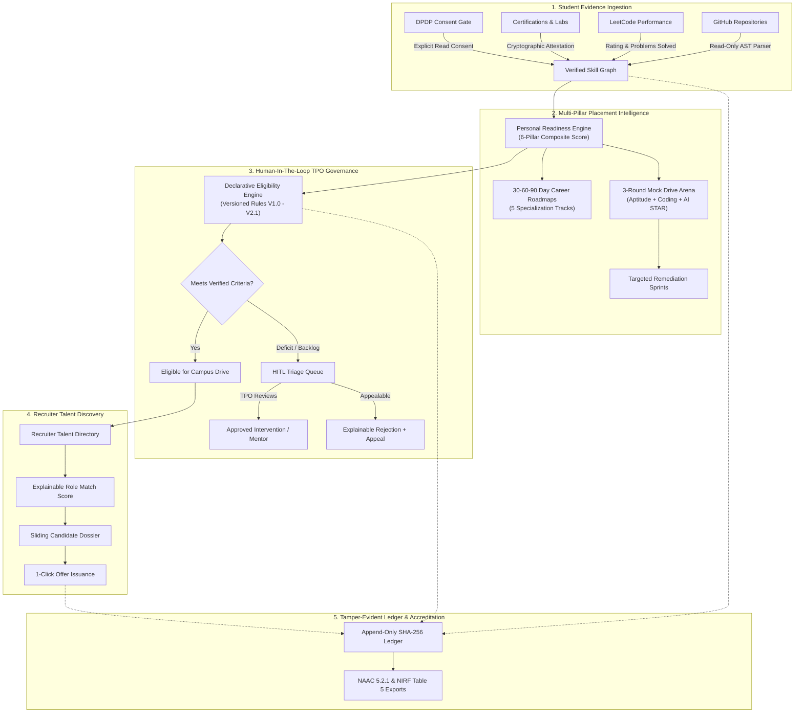
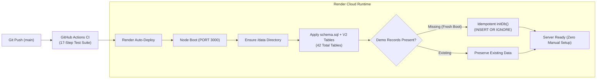

# EDTECH — Agentic Placement Intelligence Platform


**Evidence-backed campus placements, governed by humans and verified by cryptography.**


[](https://agentic-placement-intelligence.onrender.com)

[](https://github.com/nimeshsurvegg-lgtm/agentic-placement-intelligence)


[](./tests/test-suite.js)

[-339933?style=flat-square)](./package.json)

[](./services/db.js)

[](./routes/api.js)

[](./public/js/app.js)


> **Live Production Instance:** [https://agentic-placement-intelligence.onrender.com](https://agentic-placement-intelligence.onrender.com)  

> **Quick Demo Login:** Use `rahul@vppcoe.demo` (Student), `anil.kulkarni@vppcoe.demo` (TPO), or `recruiter@google.demo` (Recruiter) — Password for all demo accounts: **`Demo@1234`** *(see [full demo registry](#demo-accounts-registry))*.


---


## Table of Contents


1. [Why EDTECH](#why-edtech)

2. [Core Architectural Principles](#core-architectural-principles)

3. [Design System & Visual Identity](#design-system--visual-identity)

4. [System Architecture & Workflows](#system-architecture--workflows)

5. [Stakeholder Portals](#stakeholder-portals)

6. [Autonomous Agent Orchestra](#autonomous-agent-orchestra)

7. [Security, Privacy & Governance](#security-privacy--governance)

8. [Quickstart & Local Setup](#quickstart--local-setup)

9. [Demo Accounts Registry](#demo-accounts-registry)

10. [Technical Reference (Schema, API, Directory, Tests)](#technical-reference)


---


## Why EDTECH


Campus placements across technical institutions break down at three predictable points:


| Bottleneck | Traditional Campus Process | EDTECH Platform Approach |

| :--- | :--- | :--- |

| **Skill Trust** | Static PDF resumes and unverified claims drive 40%+ technical screening dropouts. | Server-enforced evidence chains (`Claimed -> Observed -> Evidence-Linked -> Verified -> Expired`). |

| **Intervention Timing** | Remedial bootcamps happen reactively during placement season. | Predictive batch forecasting flags skill deficits 6–12 months in advance. |

| **Auditability & Fairness** | Black-box disqualifications leave students without recourse and TPOs scrambling for NAAC/NIRF data. | Versioned declarative eligibility rules, SHA-256 audit logs, and human-in-the-loop sign-off. |


---


## Core Architectural Principles


* **No Unverified Skills:** Enforced in the data access layer—no skill transitions to `Verified` without linked cryptographic or AST-parsed evidence.

* **AI Helps, Human Decides:** Autonomous agents recommend interventions, detect deficits, and flag at-risk students, but no student is labeled, penalized, or disqualified without explicit T&P Officer sign-off.

* **Strict Multi-Tenant Isolation:** Row-level tenant scoping guarantees zero cross-college data leakage across affiliated university campuses.

* **Privacy-First Ingestion (DPDP Act 2023 Aligned):** Read-only repository AST scanning analyzes code structure without storing student source code, backed by granular consent toggles and 1-click cryptographic erasure.


---


## Design System & Visual Identity


EDTECH combines four high-utility product paradigms on a **Linear / Vercel-inspired SaaS foundation** (Midnight Navy `#060814` dark / `#f8fafc` light, Electric Indigo `#6366f1`, Inter typography on an 8px grid, 1px hairline borders, and 100% vector Lucide SVG icons):


| Paradigm | Key UI Patterns Implemented |

| :--- | :--- |

| **Public Civic Trust & Open-Ledger** | Holographic Verifiable Placement Identity Pass, live SHA-256 integrity ticker, and 1-click public verification links (no login required). |

| **Competitive Coding Arena (LeetCode)** | SVG radial solved-problem gauge, curated placement study tracks, 28-day activity heatmap, and interactive coding challenge modal. |

| **Recruiter Discovery (Wellfound)** | Active-status candidate cards, explainable mathematical match breakdowns, and sliding candidate dossier drawers. |

| **Enterprise SaaS (Linear / Stripe)** | Keyboard-friendly high-density tables, light/dark token subsystem, and strictly zero UI emojis. |


---


## System Architecture & Workflows


### Technology Stack


* **Runtime & Storage:** Node.js `v22.5+` (tested on `v26.13.0`) with native `node:sqlite` across **42 relational tables** (33 core + 9 V2 enterprise modules).

* **Backend:** Express 5.3, modular REST API (`routes/api.js`, `routes/auth.js`), `bcryptjs` (cost 12), `jsonwebtoken` (`httpOnly` cookies), and RBAC/multi-tenant middleware.

* **Frontend:** Vanilla ES2024 JavaScript SPA, CSS custom property design tokens, Chart.js, and Lucide SVGs.

* **Integrity & Exports:** Node `crypto` SHA-256 hash-chained audit ledger, Ed25519-signed W3C Verifiable Credentials 2.0 (JSON-LD), and `exceljs` for NAAC/NIRF workbooks.


### End-to-End Agentic Placement Pipeline





### Self-Healing Cloud Persistence (Render Deployment)





---


## Stakeholder Portals


### 1. Student Placement Command

* **Identity & Readiness:** Holographic Verifiable Placement ID Pass (QR + W3C JSON-LD), 6-pillar Readiness Score (Technical, Aptitude, Projects, ATS Resume, Mock Interview, Communication), and 1-click verifiable ATS resume templates.

* **Skill Verification & Practice:** Dynamic Verified Skill Graph with audit-trail modals, AST-verified Project Portfolio Studio (LOC, cyclomatic complexity, test coverage), LeetCode-style Problemset Arena, and Target Company Skill Gap Engine.

* **Interview & Mock Simulation:** 30-60-90 Day Career Roadmaps across 5 roles (Full Stack, Backend, AI/ML, Cloud/DevOps, Data Analytics), STAR-method AI Technical Interview Lab, and a timed 3-Round Mock Drive Simulator with diagnostic reports.

* **Career Operations:** Unified Opportunities Directory (Campus, Off-Campus, Internships, Hackathons), 6-stage Application Kanban Board, Verified Alumni Mentorship booking, Smart Placement Calendar (iCal export), and a context-aware AI Placement Copilot.


### 2. Training & Placement Officer (TPO) Admin

* **Intelligence & Agents:** Real-time placement KPIs (Forecast, Verified Coverage, Gap Closure, Time-to-Shortlist), Autonomous AI Agents Hub, and Controlled Agentic Workflows Studio (`WF-001` Eligibility, `WF-002` Bias Audit, `WF-003` Recruiter Match).

* **Cohort & Risk Management:** Cross-branch Cohort Skill Heatmap (CSE, IT, ECE, Mechanical) and a strictly Human-in-the-Loop Student Risk Queue (`PENDING_REVIEW` until a TPO assigns a mentor or dismisses).

* **Operations & Governance:** Corporate Recruiter CRM, Clash-Free Drive Scheduler, Bulk Mailing Campaign tool, Eligibility Override & Appeals Queue, Four-Fifths Fairness Monitor, and live SHA-256 Ledger Explorer.


### 3. Recruiter Talent Discovery Hub

* **Verified Sourcing:** Semantic multi-filter candidate search (Verified Skills, CGPA, Max Backlogs, Branch) with mathematical match explanations (e.g., *"94% Match: 4/4 Verified Core Skills, CGPA 8.42 above 7.50 cutoff"*).

* **Evaluation:** Sliding Candidate Dossiers (GitHub AST commits, contest ratings, W3C signatures), Custom Assessment Challenge Builder (MCQ, Machine Coding, STAR Audio), and Interview Slot Coordinator.


### 4. University Chancellery & Institutional Network

* **Cross-Campus Oversight:** Multi-institutional benchmarking radar across affiliated campuses (Node A, Node B, Node C).

* **Accreditation & Security:** 1-click NAAC Criterion 5.2.1 & NIRF Table 5 exporters, plus an integrated Cross-Tenant Security Leak Test Suite.


---


## Autonomous Agent Orchestra


| Agent | Function | Human Governance Gate |

| :--- | :--- | :--- |

| **Industry Skill-Gap Profiler** | Scans 500+ tech JDs to detect batch deficits (e.g., Docker, SQL optimization). | Proposes remedial clinics; TPO approves launch. |

| **Predictive Batch Analytics** | Models 6-month pre-season placement probabilities and flags at-risk students. | Flags enter `PENDING_REVIEW` queue for TPO triage. |

| **Declarative Eligibility Engine** | Deterministically evaluates students against versioned rules (`V1.0`–`V2.1`). | Every decision is logged on-chain with an appeal path. |

| **Four-Fifths Fairness Auditor** | Computes disparate impact ratios across Gender, Category, and Branch. | Alerts TPO if any cohort drops below the 0.80 threshold. |

| **AI STAR Interview Evaluator** | Grades written/spoken technical responses on architecture and STAR clarity. | Provides rubric feedback strictly as coaching. |

| **AI Placement Copilot** | Answers student career queries citing verified credentials and drive rules. | Read-only advisor; cannot alter eligibility or records. |


---


## Security, Privacy & Governance


* **Tamper-Evident SHA-256 Audit Ledger:** Every candidacy-affecting event appends a chained block:

  $$\text{Block Hash} = \text{SHA256}(\text{Index} + \text{PrevHash} + \text{Timestamp} + \text{TenantId} + \text{Payload})$$

  Users can trigger **"Verify Cryptographic Chain"** at any time to recompute hashes from Genesis forward.

* **DPDP Act 2023 Aligned Controls:** Granular consent toggles (GitHub AST read, Recruiter visibility, AI forecasting, SMS alerts), zero source-code retention, and 1-click Right to Erasure anonymization.

* **Fairness & Ethics Guardrails:** Automated four-fifths (80%) adverse impact monitoring designed to align with NYC Local Law 144 and EU AI Act transparency principles.

* **W3C Verifiable Credentials 2.0:** Exports Ed25519-signed JSON-LD credentials verifiable independently of the platform.


---


## Quickstart & Local Setup


### Prerequisites

* **Node.js:** `v22.5.0` or higher *(required for native `node:sqlite`; tested on `v26.13.0`)*

* **npm:** `v9.0.0` or higher


### 1. Clone and Install

```bash

git clone https://github.com/nimeshsurvegg-lgtm/agentic-placement-intelligence.git

cd agentic-placement-intelligence

npm install

```


### 2. Start the Server

On first boot, the server automatically creates `data/placement.db`, applies the schema, and runs idempotent demo seeding (`120` cohort students, `310` aptitude questions, `12` companies, `6` drives):

```bash

npm run dev

# or

npm start

```

Open **[http://localhost:3000](http://localhost:3000)**.


### 3. (Optional) Reset / Re-Seed & Run Tests

```bash

npm run seed   # Idempotent master database re-seed

npm test       # Execute 17-step backend integration test suite

```


---


## Demo Accounts Registry


All demo accounts share the password: **`Demo@1234`**


| Role | Name | Email | Institution / Tenant | Recommended Demo Flow |

| :--- | :--- | :--- | :--- | :--- |

| **STUDENT** | Rahul Sharma | `rahul@vppcoe.demo` | Premier Technological Institute (Node A) | ID Pass, 84.5/100 Readiness, Roadmaps, Coding Arena, Portfolio, AI Interview Lab, Kanban |

| **TP_OFFICER** | Dr. Anil Kulkarni | `anil.kulkarni@vppcoe.demo` | Premier Technological Institute (Node A) | Agentic Workflows, Cohort Heatmap, HITL Risk Queue, Recruiter CRM, SHA-256 Ledger |

| **DEPARTMENT_HEAD** | Prof. S. Rane | `hod.cs@vppcoe.demo` | Premier Technological Institute (Node A) | CS Branch Heatmap, Mentor Approvals, Remedial Workshops |

| **RECRUITER (Approved)** | Sarah Jenkins | `recruiter@google.demo` | Google India | Talent Discovery, Candidate Dossiers, Custom Challenge Builder |

| **RECRUITER (Pending)** | Vikramaditya Roy | `recruiter@barclays.demo` | Barclays Talent | Demonstrates "Awaiting TPO Verification" access gate |

| **UNIVERSITY_CHANCELLOR** | Dr. Suhas Pednekar | `chancellor@univ.demo` | University Network | Multi-Campus Benchmarks, NIRF/NAAC Exports, Cross-Tenant Leak Suite |

| **TP_OFFICER (College B)** | Dr. Sunita Deshpande | `officer@coep.demo` | National Institute of Technology (Node B) | Multi-Tenant Isolation (0% visibility into Node A records) |


---


## Technical Reference


<details>

<summary><strong>Database Schema (42 Enterprise Tables)</strong></summary>


```text

Core Identity & Auth           Skills & Evidence                Placement & Drives

├─ tenants                     ├─ skills                        ├─ companies

├─ users                       ├─ student_skills                ├─ drives

├─ sessions                    ├─ evidence                      ├─ eligibility_rule_sets

├─ password_resets             ├─ verification_rules            ├─ eligibility_decisions

└─ consents                    └─ readiness_scores              ├─ appeals

                                                                ├─ approval_queue

Preparation & Mock Engine      Enterprise V2 Modules            └─ applications

├─ mock_questions              ├─ career_roles

├─ mock_coding_problems        ├─ career_paths                  Governance & Auditing

├─ mock_interview_rubrics      ├─ portfolio_projects            ├─ audit_logs

├─ mock_attempts               ├─ opportunities                 ├─ agent_runs

├─ learning_paths              ├─ saved_opportunities           ├─ agentic_workflows

└─ learning_tasks              ├─ alumni_mentors                ├─ tpo_interventions

                               ├─ mentorship_requests           └─ erasure_requests

                               └─ hackathons

```


</details>


<details>

<summary><strong>REST API Reference (35+ Endpoints)</strong></summary>


#### Authentication (`/api/auth`)

| Method | Endpoint | Description |

| :--- | :--- | :--- |

| `POST` | `/api/auth/login` | Authenticates user and sets `httpOnly` JWT cookie |

| `POST` | `/api/auth/logout` | Clears session cookie |

| `GET` | `/api/auth/me` | Returns authenticated user profile and role |

| `POST` | `/api/auth/forgot-password` | Issues 15-minute tokenized reset link |

| `POST` | `/api/auth/reset-password` | Resets password with valid token |


#### Student Competency & Career (`/api/students`, `/api`)

| Method | Endpoint | Description |

| :--- | :--- | :--- |

| `GET` | `/api/students` | List students in current tenant |

| `GET` | `/api/students/:id` | Full student profile with skills and evidence |

| `GET` | `/api/students/:id/readiness-score` | 6-pillar readiness score, trend, and recommendations |

| `GET` | `/api/students/:id/portfolio` | AST-verified project portfolio |

| `POST` | `/api/students/:id/portfolio/project` | Add project and run AST verification audit |

| `GET` | `/api/students/:id/applications-kanban` | Applications grouped by Kanban stage |

| `POST` | `/api/applications/:id/stage` | Transition application stage |

| `GET` | `/api/students/:id/calendar-events` | Chronological placement events feed |

| `GET` | `/api/students/:id/w3c-vc` | Export W3C Verifiable Credential JSON-LD |

| `GET` | `/api/career-roles` | 30-60-90 day roadmaps across 5 roles |

| `GET` | `/api/students/:id/role-gap/:roleId` | Match percentage and skill gaps for a target role |

| `GET` | `/api/career-paths` | Market growth and salary trajectories |


#### AI Interview, Opportunities, Alumni & Copilot

| Method | Endpoint | Description |

| :--- | :--- | :--- |

| `GET` | `/api/interview/questions?role=:role` | Role-specific technical interview prompts |

| `POST` | `/api/interview/evaluate` | Evaluate STAR response via AI rubric |

| `GET` | `/api/opportunities` | Campus drives, off-campus roles, internships, hackathons |

| `POST` | `/api/opportunities/:id/save` | Toggle opportunity bookmark |

| `GET` | `/api/alumni/mentors` | List verified alumni mentors and open slots |

| `POST` | `/api/alumni/requests` | Book 1:1 session with Google Meet link |

| `POST` | `/api/ai-assistant/chat` | Context-aware AI Placement Copilot |


#### TPO Governance, Workflows & Audit Ledger

| Method | Endpoint | Description |

| :--- | :--- | :--- |

| `GET` | `/api/tpo/risk-queue` | At-risk students awaiting human TPO review |

| `POST` | `/api/tpo/interventions/assign` | Assign mentor/action plan (logged on-chain) |

| `GET` | `/api/crm/companies` | Partner recruiters, MOU status, and package history |

| `GET` | `/api/workflows/history` | Historical agentic workflow runs |

| `POST` | `/api/workflows/trigger` | Trigger eligibility or fairness audit workflow |

| `GET` | `/api/audit/entries` | Fetch raw SHA-256 blockchain blocks |

| `GET` | `/api/audit/verify` | Recalculate full chain and verify tamper-resistance |


</details>


<details>

<summary><strong>Project Directory Structure</strong></summary>


```text

agentic-placement-intelligence/

├── .github/workflows/ci.yml       # CI pipeline

├── data/

│   ├── schema.sql                 # Master DDL (33 core tables)

│   ├── placement.db               # Auto-created SQLite DB (gitignored)

│   └── db.js                      # In-memory taxonomy dictionary

├── middleware/

│   └── auth.js                    # JWT, RBAC matrix & tenant scoping

├── public/

│   ├── css/style.css              # Design system tokens (Light/Dark)

│   ├── js/

│   │   ├── icons.js               # Vector Lucide SVG provider

│   │   ├── app-v2.js              # V2 modules (Readiness, Roadmaps, Kanban)

│   │   └── app.js                 # Core SPA router & modals

│   ├── vendor/chart.min.js        # Client-side charts

│   └── index.html                 # SPA entry point

├── routes/

│   ├── api.js                     # 35+ REST endpoints

│   └── auth.js                    # Auth & password reset routes

├── services/

│   ├── db.js                      # Native SQLite DAL & SHA-256 ledger

│   ├── initDb.js                  # Idempotent startup seeder

│   ├── authService.js             # Token & credential service

│   ├── declarativeEligibility.js  # Versioned rule engine (V1.0–V2.1)

│   ├── aiAgents.js                # Skill-gap & predictive analytics agents

│   ├── mockDriveEngine.js         # 3-round mock drive scoring engine

│   ├── fairnessMonitor.js         # Four-fifths disparate impact monitor

│   ├── accreditationExporter.js   # NAAC 5.2.1 & NIRF Table 5 exporter

│   └── crossTenantLeakTest.js     # Tenant isolation verification suite

├── scripts/

│   ├── seed.js                    # Manual idempotent seeder

│   ├── migrate_v2.js              # V2 schema migration (9 tables)

│   └── test_v2_endpoints.js       # Live API smoke test

├── tests/

│   └── test-suite.js              # 17-step automated integration suite

├── server.js                      # Express entrypoint (Port 3000)

├── package.json

├── CODE_OF_CONDUCT.md

├── CONTRIBUTING.md

├── SECURITY.md

└── LICENSE

```


</details>


<details>

<summary><strong>Automated Test Suite Output (17/17 Passing)</strong></summary>


```text

Starting Agentic Placement Intelligence Platform Test Suite...


  [PASS] Audit Ledger: Genesis Block created and chained

  [PASS] Audit Ledger: SHA-256 Tamper-evident integrity verification

  [PASS] Eligibility Engine: Evaluates Rahul Sharma against Rule V2.1

  [PASS] Eligibility Engine: Correctly marks Rohan Patil as Ineligible due to active backlog

  [PASS] Industry Skill Gap Profiler Agent: Detects Docker and SQL deficits

  [PASS] Predictive Analytics Agent: Generates batch forecast & at-risk triage

  [PASS] Mock Drive Engine: Aptitude scoring across 30 questions

  [PASS] Mock Drive Engine: Machine coding test syntax & window function checks

  [PASS] Fairness Monitor: Calculates four-fifths impact ratio for Gender and Category

  [PASS] Accreditation Exporter: Generates NAAC Criterion 5.2.1 report

  [PASS] Cross-Tenant Leak Suite: Validates data isolation and zero cross-tenant leakage

  [PASS] Database Service: Auto-initializes on startup and populates demo student STU-VPCOE-042

  [PASS] Database Service: Multi-tenant DAL retrieves enriched student skills and evidence

  [PASS] Database Service: Gracefully returns null for non-existent student without crashing

  [PASS] Database Service: Safe initialization is strictly idempotent (zero duplicates or errors)

  [PASS] Database Service: V2 enterprise tables (readiness, roadmaps, opportunities) initialized

  [PASS] Database Service: Supports fresh DB creation with schema and safe auto-seeding


======================================================

Test Execution Summary: 17/17 Passed

Status: ALL TESTS PASSED

======================================================

```


</details>


---


**License:** See [LICENSE](./LICENSE) · **Security:** See [SECURITY.md](./SECURITY.md) · **Contributing:** See [CONTRIBUTING.md](./CONTRIBUTING.md)
